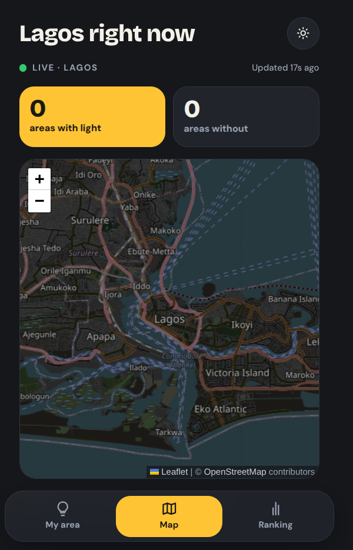

# Light Dey?

**Is there light in your area right now? Ask the people who live there.**

Light Dey? is a crowdsourced power-supply tracker for Nigeria. People report whether there is light (NEPA) in their area, and everyone else sees the live picture on a map, before they leave home, plan their day or decide whether to buy fuel.

Live: **https://lightdeyng.vercel.app**



---

## Why it exists

In most Nigerian neighbourhoods, the only way to know if light has been restored is to call someone at home or check WhatsApp groups. DisCos don't publish real-time supply data at street level.

Light Dey? turns the people already living with the problem into the data source. It started as an idea on my WhatsApp status, and the response was big enough, including from people outside Ilorin, that I built it.

## Features

- **Live map** of reported supply by area: light on or light off, and how recently it was reported
- **Area leaderboard** showing which areas are getting the most supply
- **WhatsApp share cards** so a report can be shared straight to status or groups
- **"Notify me when light comes"**: subscribe to your area and get alerted when people report that supply is back
- **Location-locked reporting**: you can only report for the area you are physically in right now, which keeps the data honest

## Coverage

Launched in core areas of **Ilorin** (Apalara, Alagbado, Okolowo, Okefoman, Adeta and more) and **Lagos** (including Lagos Island). More states are coming.

## Tech stack

| Layer | Tools |
| --- | --- |
| Frontend | Next.js, TypeScript |
| Backend and database | Supabase (Postgres, auth, realtime) |
| Hosting | Vercel |

## Key decisions

**Reports are tied to where you are, not where you say you are.**
Anyone could claim their area has light. To stop that, a report is only accepted for the area matching the reporter's current location. This rule protects the whole map.

**Fresh reports matter more than old ones.**
Power status changes by the hour. The map shows how recent each area's latest report is, so an old "light on" isn't taken as current.

**Built for sharing.**
Most of the audience lives on WhatsApp, so every report can become a share card. Growth comes from people posting their area's status.

**No emojis in the product.**
Every status and action uses real icons, so the app reads cleanly and consistently on every device.

## Running it locally

```bash
git clone https://github.com/doyinsola-coder/<repo-name>.git
cd <repo-name>
npm install
```

Create a `.env.local` file in the project root:

```bash
NEXT_PUBLIC_SUPABASE_URL=your-supabase-project-url
NEXT_PUBLIC_SUPABASE_ANON_KEY=your-supabase-anon-key
```

Then start the dev server:

```bash
npm run dev
```

Open http://localhost:3000.

## What's next

- In-app polls and feedback, such as prepaid card vs analog meter preference and monthly vs yearly meter payment, to collect supply and metering data at scale
- Coverage for more Nigerian states

## Follow

- X: [@LightDeyng](https://x.com/LightDeyng)
- TikTok: [@light.dey](https://www.tiktok.com/@light.dey)

---

Built by **Abdulmubeen Doyinsola Abdullateef**, full-stack developer, Ilorin.
[GitHub](https://github.com/doyinsola-coder) · [X](https://x.com/TheMaleDoyin)